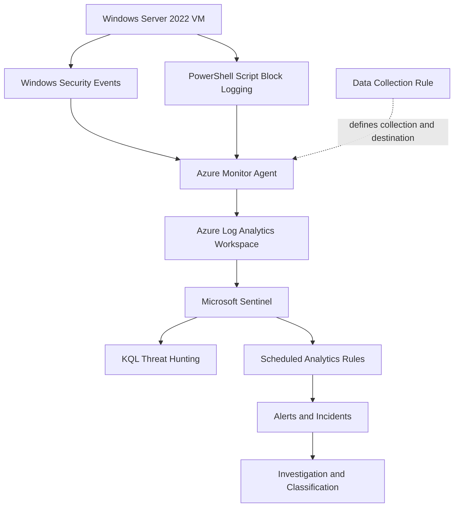

# Microsoft Sentinel Threat Detection & Incident Investigation Lab

  <strong>Hands-on SIEM Engineering | Windows Security Monitoring | KQL Threat Hunting | Detection Engineering | Incident Investigation</strong>

  
  
  
  

## Project Overview

This project implements a hands-on Security Information and Event Management (SIEM) lab using Microsoft Sentinel and Microsoft Azure.

The objective was to build a working security monitoring environment, collect Windows security telemetry, develop Kusto Query Language (KQL) threat-hunting queries, implement scheduled analytics detections and investigate the resulting security incidents.

The lab uses a Windows Server virtual machine as its telemetry source. Azure Monitor Agent collects configured Windows events through a Data Collection Rule and forwards them to a dedicated Azure Log Analytics workspace monitored by Microsoft Sentinel.

The project covers the complete basic monitoring workflow:

**Telemetry Generation → Data Collection → Log Ingestion → Threat Hunting → Detection → Alert Generation → Incident Investigation**

## Project Objectives

- Build a cloud-based Windows security monitoring environment.
- Configure Azure Monitor Agent and Data Collection Rules.
- Collect and analyze Windows Security events.
- Enable PowerShell Script Block Logging.
- Develop and execute KQL threat-hunting queries.
- Implement scheduled analytics detection rules.
- Map detection behavior to MITRE ATT&CK.
- Generate and investigate controlled security incidents.
- Document findings, limitations and detection improvements.

## Architecture

## Technology Stack

| Technology | Role |
|---|---|
| Microsoft Azure | Cloud infrastructure |
| Microsoft Sentinel | SIEM and security monitoring |
| Azure Log Analytics | Centralized log storage and querying |
| Azure Monitor Agent | Windows telemetry collection |
| Data Collection Rules | Event collection configuration |
| Windows Server 2022 | Monitored endpoint |
| Windows Security Logs | Authentication, process and security events |
| PowerShell | Controlled testing and script logging |
| Kusto Query Language | Threat hunting and detection logic |
| MITRE ATT&CK | Detection behavior mapping |
| GitHub | Source control and technical documentation |

## Implementation Highlights

### 1. Infrastructure and Telemetry

- Deployed a Windows Server 2022 Azure virtual machine.
- Configured a Log Analytics workspace.
- Enabled Microsoft Sentinel.
- Installed and verified Azure Monitor Agent.
- Created and associated a Data Collection Rule.
- Configured Windows Security event collection.
- Enabled PowerShell Script Block Logging for Event ID 4104.
- Verified telemetry ingestion into the `SecurityEvent` table.

### 2. KQL Threat Hunting

Eight queries were executed and their results inspected.

| ID | Query | Event IDs |
|---|---|---|
| KQL-01 | Process Execution Analysis | 4688 |
| KQL-02 | Failed Logon Analysis | 4625 |
| KQL-03 | PowerShell Script Activity Analysis | 4104 |
| KQL-04 | Local Account and Group Enumeration | 4798, 4799 |
| KQL-05 | Privileged Group Enumeration | 4799 |
| KQL-06 | Successful Logon Analysis | 4624 |
| KQL-07 | Privileged Service Activity | 4673 |
| KQL-08 | Scheduled Task Modification | 4702 |

[Explore the KQL library](kql/README.md)

### 3. Detection Engineering

Three scheduled analytics detections were implemented.

| ID | Detection | Event ID | Severity |
|---|---|---:|---|
| DET-01 | Multiple Failed Logons | 4625 | Medium |
| DET-02 | Suspicious PowerShell Activity | 4104 | Medium |
| DET-03 | Suspicious Local Group Enumeration | 4799 | Medium |

Each rule was configured with a five-minute execution frequency and a five-minute lookup period.

All three detections generated alerts and associated Sentinel incidents during controlled testing.

[Explore detection documentation](detections/README.md)

### 4. Incident Investigation

Three Sentinel alerts were generated and investigated in the Defender Cases experience. Case labels are used here instead of cloud incident identifiers.

| Case | Detection | Current Status |
|---|---|---|
| CASE-14 | Multiple Failed Logons | Resolved |
| CASE-28 | Suspicious PowerShell Activity | Closed |
| CASE-29 | Suspicious Local Group Enumeration | Closed |

For all three alerts, controlled test activity was classified as Informational, expected activity, with Security testing recorded as the determination. CASE-14's alert is Resolved; CASE-28 and CASE-29 are Closed. Alert status and case status are distinct workflow fields.

The incidents demonstrate that detection alerts require investigation and contextual analysis rather than automatic assumptions of compromise.

[Explore investigation reports](investigations/README.md)

## Controlled Testing

The lab used controlled activity to validate telemetry collection and detection behavior.

Examples include:

- Repeated failed authentication attempts using an intentionally incorrect password.
- Benign PowerShell Base64 decoding using `FromBase64String`.
- Local Administrators group enumeration using `Get-LocalGroupMember`.

These tests generated the corresponding Windows events and allowed the analytics rules to be evaluated.

**Important:** These were controlled lab tests, not actual attacks or evidence of a compromised system.

## Repository Navigation

| Directory | Contents |
|---|---|
| [`docs/`](docs/README.md) | Architecture, environment, deployment, telemetry and methodology |
| [`kql/`](kql/README.md) | Eight KQL threat-hunting query documents |
| [`detections/`](detections/README.md) | Three scheduled analytics detection documents |
| [`investigations/`](investigations/README.md) | Three incident investigation reports |
| [`evidence/`](evidence/README.md) | Evidence index and screenshot collection guide |

## Key Learning Outcomes

This implementation provided hands-on experience with:

- Cloud-based SIEM deployment.
- Windows security event monitoring.
- Azure Monitor Agent and DCR configuration.
- PowerShell Script Block Logging.
- KQL query development and analysis.
- Scheduled detection engineering.
- MITRE ATT&CK mapping.
- Alert triage and incident investigation.
- Evidence-based security analysis.
- False-positive awareness and detection limitations.

## Security Considerations

- The VM was deployed without a public IP address.
- No inbound ports were exposed to the internet.
- System-assigned managed identity was enabled.
- Public documentation uses generalized Azure resource labels; credentials, subscription identifiers and sensitive workspace details must not be published.
- Controlled test activity was performed within the lab environment.

## Limitations

- Single Windows Server endpoint.
- Limited Windows event collection scope.
- Three scheduled analytics detections.
- Limited controlled testing scenarios.
- No automated incident response or remediation.
- No multi-endpoint enterprise monitoring.
- Some exploratory queries require deeper event-level investigation.

This is a learning and demonstration environment, not a production enterprise SOC deployment.

[Read the full limitations and future roadmap](docs/limitations-and-future-work.md).

[Review the validation and evidence matrix](docs/validation-matrix.md) for recorded test outcomes and outstanding work.

[Read the technical walkthrough](docs/technical-walkthrough.md) for an end-to-end explanation and interview guide.

[Read the repository review report](docs/repository-review.md) for review scope, security checks and outstanding technical follow-up.

## Evidence and Screenshots

**Evidence status:** The screenshot inventory contains 25 planned items; none had been committed to the repository at the time of this review. Actual screenshots must be captured from the Azure and Sentinel environment before the evidence section can be considered complete.

[View the evidence index](evidence/README.md).

## Future Improvements

- Expand monitoring to additional Windows endpoints.
- Introduce Linux security telemetry.
- Develop additional authentication and persistence detections.
- Improve detection correlation and entity mapping.
- Integrate threat intelligence enrichment.
- Develop Sentinel investigation playbooks.
- Explore automation rules and Logic Apps.
- Build security monitoring dashboards.
- Expand detection testing and MITRE ATT&CK coverage.

## Project Information

**Project:** Microsoft Sentinel Threat Detection and Incident Investigation Lab

**Category:** Cybersecurity | Security Operations | SIEM | Threat Detection

**Environment:** Microsoft Azure

**Repository:** [GitHub — Microsoft Sentinel Threat Detection Lab](https://github.com/Sankrityayana/microsoft-sentinel-threat-detection-lab)

---

*This repository documents a hands-on technical implementation and controlled security testing environment. All findings and conclusions are limited to the evidence collected in this lab.*
