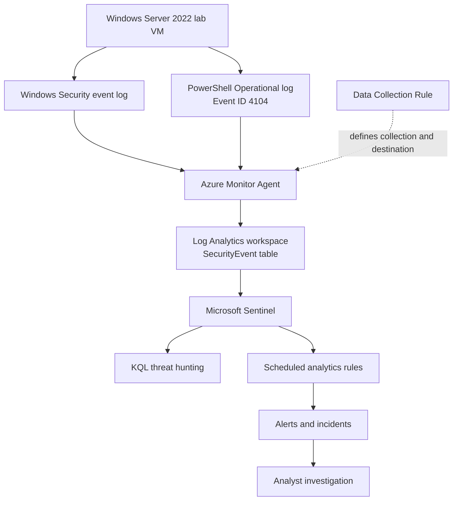

# System Architecture

## 1. Overview

The Microsoft Sentinel Threat Detection and Incident Investigation Lab is a cloud-based security monitoring environment built on Microsoft Azure.

The lab collects Windows security telemetry from a Windows Server virtual machine, forwards the events to an Azure Log Analytics workspace through Azure Monitor Agent (AMA), and uses Microsoft Sentinel for threat hunting, scheduled detection and incident investigation.

## 2. Architecture Components

| Component | Purpose |
|---|---|
| Microsoft Azure | Cloud infrastructure hosting the lab |
| Windows Server 2022 VM | Source of Windows security telemetry |
| Azure Monitor Agent (AMA) | Collects and forwards configured event logs |
| Data Collection Rule (DCR) | Defines which Windows events are collected |
| Log Analytics Workspace | Central repository for collected security events |
| Microsoft Sentinel | SIEM platform for threat detection and investigation |
| Kusto Query Language (KQL) | Used for threat hunting and detection logic |

## 3. Implemented Telemetry and Detection Flow

The diagram represents the implemented data path and the documented analytics workflow. It is a logical view, not a network topology diagram.

## 4. Telemetry Flow

1. Windows Server generates Security and PowerShell Operational events.
2. Azure Monitor Agent collects configured events.
3. The associated DCR defines the collection configuration and destination.
4. AMA forwards configured telemetry to the Log Analytics workspace.
5. Microsoft Sentinel uses the workspace data for analytics, threat hunting and investigation.
6. Scheduled analytics rules identify matching activity and generate alerts and incidents.
7. The analyst investigates underlying events and records findings.

## 5. Data Collection

The DCR collects configured Windows Security events and PowerShell Script Block Logging events.

The PowerShell Operational channel is configured for Event ID 4104.

Collected records used in the lab are available in the `SecurityEvent` table.

**Important distinction:** The Windows Security event IDs documented in the KQL library are events examined during the lab. They should not be interpreted as individually configured DCR filters unless the collection configuration explicitly shows that.

## 6. Detection and Investigation

Three scheduled analytics detections were implemented:

- Multiple Failed Logons — Event ID 4625
- Suspicious PowerShell Activity — Event ID 4104
- Suspicious Local Group Enumeration — Event ID 4799

Eight KQL hunting queries were executed to examine process execution, authentication, PowerShell activity, account and group enumeration, privileged service activity and scheduled task modifications.

## 7. Security Considerations

- The lab VM was deployed without a public IP address.
- No inbound ports were exposed to the internet.
- System-assigned managed identity was enabled.
- Public documentation uses generalized Azure resource names.
- Credentials, subscription identifiers and sensitive workspace details must not be published.

## 8. Scope

This architecture describes a single-VM hands-on lab. It is not a production enterprise SOC deployment and does not represent a multi-endpoint security architecture.

---

**Project:** Microsoft Sentinel Threat Detection and Incident Investigation Lab
